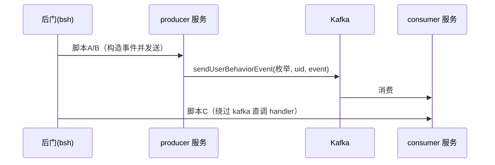

# 示例：命中非 IM 策略事件（hit_direct_strategy）后门测试脚本文档

> 本示例随 skill 包自带，用于展示后门 bsh 测试文档的完整形态；具体类名/bean 名为虚构工程的示例值，使用时替换为目标工程的真实调用链。

## 目的

通过后门 `com.immomo.ultron.backdoor.moa.impl.BackDoorMoaServiceImpl#execute` 执行 bsh 脚本，手动触发/验证 `hit_direct_strategy` 命中事件全链路。

后门入口约束：

- MOA URI：`/service/{spring.application.name}-backdoor`（按目标服务拼）。
- 入参 `code` 为 bsh 脚本文本；脚本内可直接用变量 `context`（Spring `ApplicationContext`），已开启 `setAccessibility(true)`。
- 脚本最后一行表达式的值作为返回值；异常时返回 `e.getMessage()`。

## 链路背景



事件 Ticket 结构：

| 字段 | 类型 | 说明 | 示例 |
|---|---|---|---|
| uid | String | 命中用户 | `123456789` |
| strategyId | String | 二级策略编码 | `FRAUD_PROFILE` |
| date | String | 命中日期 `yyyy-MM-dd` | `2026-10-13` |
| createTimestamp | Long | 事件创建时间（epoch ms） | `1770000000000` |
| ext | String | 命中详情 JSON | `{"hitField":"NICKNAME"}` |

## 脚本 A：发送侧——显式构造并发送事件（推荐）

在 producer 服务后门执行，真实发送 kafka 消息，验证生产→消费全链路。

多行版（`/* */` 块注释，可直接提交）：

```java
uid = "123456789";
sid = "FRAUD_PROFILE";
extDto = new com.example.bean.StrategyHitExtDto()
    .setHitField("NICKNAME")
    .setHitContent("bsh-test-hit-content")
    .setAuditStrategyName(sid);
now = System.currentTimeMillis();
today = new java.text.SimpleDateFormat("yyyy-MM-dd").format(new java.util.Date(now));
ticket = new com.example.bean.HitDirectStrategyEvent.Ticket()
    .setUid(uid).setStrategyId(sid).setDate(today)
    .setCreateTimestamp(new Long(now))
    .setExt(com.example.util.JsonUtilsV2.toJSONV2(extDto));
event = new com.example.bean.HitDirectStrategyEvent().setTicket(ticket);
producer = context.getBean("userBehaviorEventProducerService");
future = producer.sendUserBehaviorEvent(
    com.example.enums.UserBehaviorEvent2Enum.hit_direct_strategy, uid, event);
future.get();
"send ok: uid=" + uid + " date=" + today;
```

## 脚本 B：直调真实私有方法（差异段）

事件构造同脚本 A（uid/sid/extDto 赋值段照抄）；getBean 返回 AOP 代理，解包后在裸 target 上直调（`setAccessibility(true)` 允许）：

```java
/* ===== 取 bean；若为 AOP 代理则解出原始对象（私有方法不在代理类上） ===== */
port = context.getBean(com.example.port.IAuditPort.class);
target = port;
if (org.springframework.aop.support.AopUtils.isAopProxy(port)) {
    target = ((org.springframework.aop.framework.Advised) port).getTargetSource().getTarget();
}

target.sendHitDirectStrategyEvent(uid, sid, extDto);

"OK uid=" + uid + " targetClass=" + target.getClass().getName();
```

## 脚本 C：消费侧直调 handler（差异段）

事件构造同脚本 A，另加 wrapper 构造；handler 实现接口时是 JDK 代理，须**按 bean 名取**（按具体类取会失败），解代理后调用：

```java
/* ===== 构造 wrapper（静态泛型方法可调用） ===== */
wrapper = com.example.bean.UserBehaviorEventWrapper.newEventWrapper(
    com.example.enums.UserBehaviorEvent2Enum.hit_direct_strategy, uid, event);

/* ===== 按名取 bean + 解代理 ===== */
handler = context.getBean("hitDirectStrategyBehaviorHandler");
target = handler;
if (org.springframework.aop.support.AopUtils.isAopProxy(handler)) {
    target = ((org.springframework.aop.framework.Advised) handler).getTargetSource().getTarget();
}

target.handleDirectStrategyHit(event, wrapper);

"handled: uid=" + uid + " eventId=" + wrapper.getId();
```

## 成功判据

1. moa 返回 `result` 为末行字符串（返回对象 = 注释吞行、未完整执行）。
2. producer 服务日志出现 `sendUserBehaviorEvent success`；consumer 服务出现 handler 日志。

## 注意事项

- **注释吞行**：多行脚本的换行会被调用平台抹平，`//` 行注释会吞掉其后全部代码（首行即注释时整个脚本被吞、返回 null）；多行版一律用 `/* */` 块注释。
- **AOP 代理**：私有方法/非接口方法须解代理后调用。
- **幂等与灰度**：消费侧幂等键每次新生成可重放；灰度外 uid 事件静默丢弃。
- **判罚副作用**：命中可能触发自动判罚，用测试 uid。
