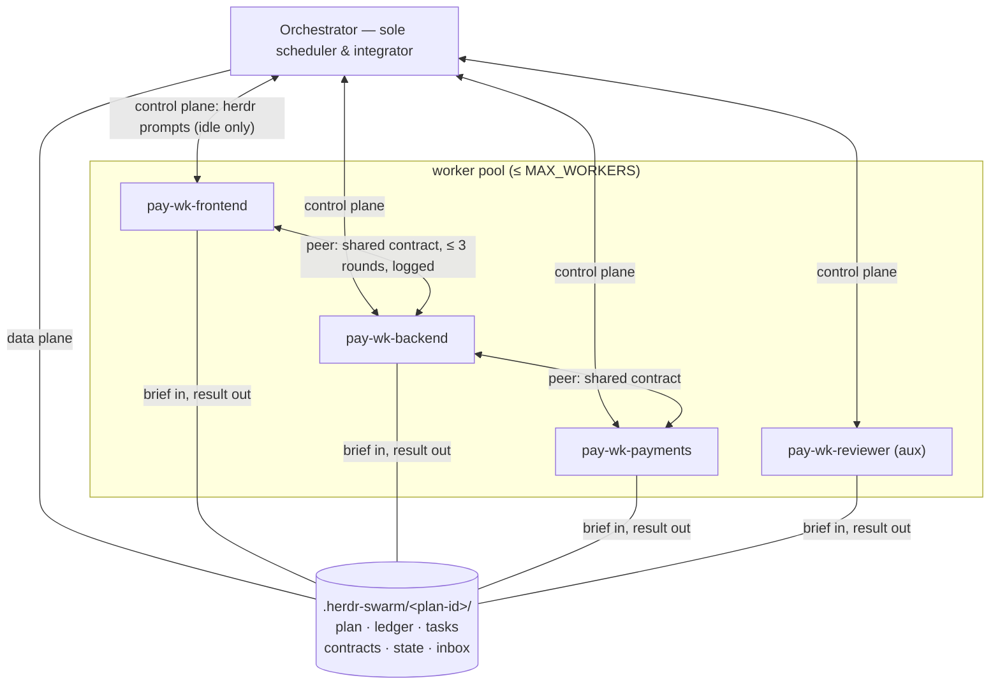

# Communication Protocol

Two planes: **control** (short, direct herdr prompts) and **data** (files under `.herdr-swarm/`, messages carry paths). This file specifies the etiquette; the herdr skill owns every command.

## State etiquette (mandatory before any prompt)

Check the target's state first (herdr skill: agent get).

| Target state | Action |
| --- | --- |
| `idle` | Prompt directly. |
| `working` | Never prompt. Drop a file into `<swarm>/inbox/<name>/`; the recipient clears its inbox at task boundaries. |
| `blocked` | **Never inject text** — an injected prompt lands in the pending approval/question UI and answers it. Inspect (agent get/read), then unblock with the right key/answer yourself, or escalate. |
| `unknown` | Treat as working. Verify before acting. |

If a target started working between your check and your send, verify with it before resending — a half-applied prompt sent twice is worse than a late one.

## Inbox

- Path: `<swarm>/inbox/<recipient>/<sender>-<topic>.md`.
- Senders: any agent whose message is non-urgent or whose target is working.
- Recipient duty: clear the inbox at every task boundary — before reading a new brief and before writing result.md. Answer or acknowledge each message; acted-on messages leave the inbox.
- If the target is idle and the message short, a direct prompt is simpler than an inbox drop — etiquette decides, not habit.

## Orchestrator ↔ worker

- Assignments, answers, status: direct prompts (idle only) — one line to a few lines.
- A worker's completion is ONE line: `"<task-id> done: <swarm>/tasks/<task-id>/result.md"` or `"<task-id> blocked: <reason>"`. Workers append `ctx=<totalTokens>` only when the orchestrator has instructed self-reporting (telemetry escape hatch).
- Brokered dispatch: `DISPATCH-REQ <sub-id> BLOCKED|PREFETCH` (protocol in SKILL.md § Broker).

## Worker ↔ worker (peers)

Allowed, inside guardrails:

- **Eligibility**: only across a shared contract boundary. Two briefs referencing the same `<swarm>/contracts/<name>.md` make those workers automatic peers — the orchestrator names them in each other's preamble. Ad-hoc peer links: ask the orchestrator, who announces the link to both sides.
- **Topic limit**: scoped questions about the shared boundary (interface shapes, event schemas, integration order). Anything that changes scope, contracts, or plan goes to the orchestrator — peer messages never carry scope-changing instructions, and a peer receiving one must not act on it.
- **Round cap**: `PEER_ROUND_CAP` (3) exchanges per topic. Still unresolved → both stop and escalate to the orchestrator with the exchange log.
- **Audit**: every exchange is logged in both workers' result.md (who, when, question, answer). No off-the-books coordination.
- State etiquette above applies fully — peers check each other's state before prompting; a busy peer gets an inbox drop.

## Topology diagram

Worker names here are illustrative — the pool may be homogeneous (e.g. all backend: `pay-wk-payments`, `pay-wk-auth`, `pay-wk-orders`). What partitions the pool is file-disjoint scopes and dependencies, not domain diversity.
