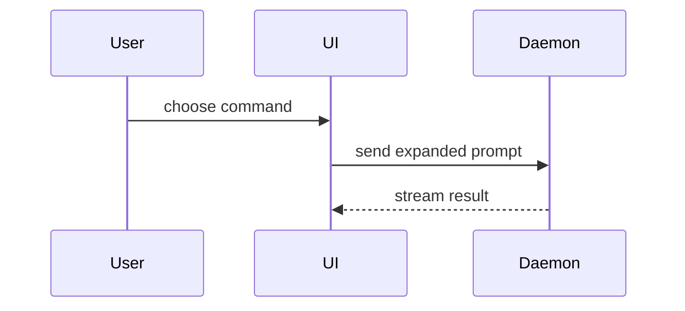

Help the user understand the current topic of conversation visually. Skip the preamble and keep prose brief. Pick the smallest view that makes the key point clear. The reply text still starts with the conclusion: a view supports it, it does not replace it.

- Show logic or an algorithm as pseudocode:

```text
on(save)
  if content is unchanged
    return cached result
  write new content
  return fresh result
```

- Show runtime control flow as a call tree:

```text
submitForm
  createSession
    persistPrompt
    launchAgent
  navigateToSession
```

- Show UI structure as a component tree, including state and module boundaries that matter:

```tsx
<SessionPage> (apps/example/src/routes/session.tsx)
  useSessionEvents()
  <SessionToolbar>
    <RunSkillButton> (packages/ui)
```

- Show file responsibility or a broad refactor as a shallow file tree:

```text
src/
├── commands/       # parses user actions
├── sessions/       # owns session state
└── transport/      # sends API requests
```

- Show component interaction, control flow, data flow, a data model or a small chart with Mermaid. In Claude Code, the merman mod draws these fences in the terminal: `flowchart` / `graph`, `sequenceDiagram`, `stateDiagram`, `classDiagram`, `erDiagram`, `xychart-beta`, `pie`, `gantt` and C4. A diagram over 80 lines or 8,000 characters, or wider than the window, shows as source: split it when each part answers the question by itself, otherwise take the page route. On other hosts, take the page route for a diagram the reader must see drawn.



- Use `diff` when the point is what changes and the surrounding shape already exists. Match the diff shape to the topic.

For a component change:

```diff
 <SessionPage>
   useSessionEvents()
   <SessionToolbar>
+    <RunSkillButton />
   <SessionTimeline>
+    <SkillResultCard />
```

For a file-layout change:

```diff
 src/
 ├── commands/
+│   └── show-me.ts       # expands the slash command
 ├── sessions/
-└── transport.ts
+└── transport/
+    ├── client.ts
+    └── stream.ts
```

For a call-tree or call-stack change:

```diff
 submitForm
   createSession
     persistPrompt
+    expandSkillMention
     launchAgent
-  navigateToSession
+  navigateToSession
+    subscribeToEvents
```

For a state or control-flow change:

```diff
 on(save)
-  write content
+  if content is unchanged
+    return cached result
+  write new content
+  invalidate cache
```

- Show the whole block when most of it is new, when omitted context would hide ownership or order, or when the user needs a copyable target shape:

```ts
function expandSkill(command: string): string {
  const skillName = command.slice(1)
  return `use the ${skillName} skill`
}
```

- One diagram or one table stays inline. Render one page with the `am` CLI (see "Page route" below) when one inline view cannot carry the answer: it needs 3+ views read together, a diagram past the Mermaid limits above, real code quoted next to a diagram, or decisions the user answers on the page.

- For a visual UI, layout, interaction or animation that no `am` component draws (`am list` names them), write one focused HTML file — a diagram, an infographic, or a short slide deck, whichever fits the point. Match the product's colors, type, spacing, and components; use real labels and data; support desktop and mobile. Then open it for the user:

```
Bash(open path/to/show-me-{description}.html)
```

When the user will share that page and the host has an artifact tool, publish it with that tool instead.

### guidance

Place each visual next to the short text it supports. Keep only the calls, files, props, states, and boundaries needed to answer the user's current question or the options to resolve the current discussion point.

You may use one of these, you may use several, it is unlikely you will use all of them. Use your judgement and don't overwhelm the user.

## Page route

A reply to a parent agent (a delegated report) gets no page unless the task asks for one. Return the text it asked for.

The page comes from the vendored answer-me-with-html CLI. Its own skill file is the manual. `am` means this wrapper, in every command:

```bash
"${CLAUDE_SKILL_DIR}/scripts/am"
```

In Claude Code the command above already carries the skill path. On other hosts, write the absolute path of the directory that holds this `SKILL.md` into it. The shell keeps no variable between calls, so copy the full command into every call.

1. Run `am skill-dir`. It prints the absolute path of the upstream skill directory (`<dir>`). If it prints `am CLI not found`, run the command it prints.
2. Read `<dir>/SKILL.md`, sections 2 to 7. Read a file under `<dir>/references/` when those sections send you there. When the user asks to change a page setting or clean up pages, read section 0.
3. Follow those sections, with these changes. Where the upstream text and this list differ, this list wins:
   - When to make a page: this skill decides (the list above). Skip upstream section 1, including its always-on mode.
   - Commands: use `am` (this wrapper) where the upstream text writes `node "${CLAUDE_SKILL_DIR}/scripts/am.mjs"`. In upstream file paths, replace `${CLAUDE_SKILL_DIR}` with `<dir>`.
   - Reply: give the conclusion and its key evidence as text, at the length the content needs, then end with the page link. The upstream 2–3 line limit does not apply.
   - Updates: an upgrade is a submodule bump in the ai-assets repo. When the CLI prints `! Update hint`, or the user asks to update, tell the user that, and leave the upstream update commands unrun.
4. The page route is done when the render prints `✓ <path>` and the reply ends with the link to that path.

When the user pastes a page reply (it starts with `# Re:`), run `am skill-dir`, then follow section 5 of `<dir>/SKILL.md`.
